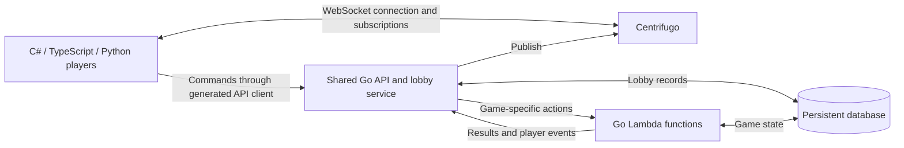

# Multiplayer architecture decision

Date: 2026-09-20  
Status: Keep Centrifugo and the existing Go/Huma/PostgreSQL architecture. The generic lobby and Huma-generated Python client are implemented; Lambda routing, round deadlines and C#/TypeScript clients remain planned. See the [implementation evidence](tasks/generic-lobby/implementation-status.md) for verification status.

Implementation planning: [generic lobby task pack](tasks/generic-lobby/README.md) defines the package/API contracts, schema policy, parallel work order, and required tests. The task pack is not an implementation completion report.

## Requirements

- Support multiple independent casual games, such as quizzes and drawing/guessing games, through shared infrastructure.
- Run generic multiplayer and lobby behavior in Go, with a small deployment that can initially fit on one server.
- Run game-specific rules in Go AWS Lambda functions and keep durable game state in a database.
- Support actual player clients in C# (Unity or Godot), browser TypeScript, and Python. Python backend support is optional; Python player support is required.
- Generate API clients and message types where practical instead of maintaining equivalent definitions manually in every language.
- Reuse connection management, subscriptions, presence, and recovery rather than implement another networking protocol.

Twenty lightly used games is a deployment goal, not a measured capacity guarantee. Concurrent players, room sizes, message fan-out, payload sizes, and database activity matter more than the number of game titles.

## Decision and tradeoff

Keep Centrifugo as the persistent connection and event-delivery service. Build a reusable lobby layer in the existing Go backend and route game-specific actions to Lambda as that integration is implemented.

Centrifugo fits an external game backend naturally and lets multiple games share one messaging deployment. It does not supply a complete lobby framework: membership, join codes, capacity, host selection, ready/start rules, and reconnect grace periods remain application responsibilities. These should be implemented once in the shared lobby service.

Use the existing standalone Centrifugo server. Embedding the related [Centrifuge Go library](https://github.com/centrifugal/centrifuge) is an alternative if a single custom executable becomes important, but is not required by this decision. Centrifuge is the server library; `centrifuge-go` is a client SDK.

## Current repository versus intended design

| Area | Current implementation | Intended direction |
| --- | --- | --- |
| Backend | [Go/Huma/Chi HTTP server](../../backend/main.go), GORM/PostgreSQL, game logic under `backend/` | Keep the stack; add shared lobby behavior and game-action routing |
| Messaging | [Centrifugo configuration](../centrifugo/centrifugo-config.toml), authorized subscribe/refresh proxies, a push to Centrifugo's HTTP API after each commit, and history on the `lobby` and `player` namespaces | Keep Centrifugo transport recovery with HTTP snapshot reconciliation |
| Connections | [Generic lobby](../README.md): guest credentials, explicit create/join, teams and durable per-client leases | Account identity and additional games can reuse the boundary |
| Clients | [Go example](../clients/main.go) and [generated Python client](../clients/lobby-python/README.md) | Add and validate C#/TypeScript player flows |
| Deployment | [Compose infrastructure](../../docker-compose.yml) includes PostgreSQL and Centrifugo | Initially share one host; add Lambda integration separately |

Generic lobby commands now use HTTP, with Centrifugo for authenticated subscriptions and invalidations. The old connect/RPC lobby flow has been removed. Lambda routing, game-specific generated clients and C# engine compatibility remain unimplemented; later sections retain the broader architectural direction.

## Intended architecture

| Component | Responsibility |
| --- | --- |
| Go API and lobby service | Authentication, room creation/join codes, membership, capacity, host/ready state, channel authorization, reconnect policy, generic deadlines, Lambda dispatch |
| Centrifugo | Persistent connections, subscriptions, presence, publication delivery, configured history and recovery |
| Go Lambdas | Game rules: answer/guess validation, scoring, round progression, and game-specific state changes |
| Database | Authoritative durable lobby and game state |

Keep PostgreSQL initially. Another store can be evaluated later without coupling it to the client transport. Lambda needs an explicit network/authentication path to the database, with connection usage bounded if using PostgreSQL. Lambda is not automatically cheaper than running handlers on an already provisioned Go server; invocation, networking, and database costs must be included.

Scope room records and channels by game and room identifiers, and enforce membership when authorizing subscriptions. Use private player channels for information that must not be broadcast to the whole room. Channel naming by itself does not provide isolation.

### Example: submit a quiz answer

1. The generated client calls a typed `SubmitAnswer` operation with the room, question, answer, and an operation identifier.
2. The Go API authenticates the player, checks membership, and selects the appropriate game Lambda.
3. Lambda validates the action against current state and commits the result without overwriting concurrent changes or awarding points twice on retry.
4. Lambda returns the command result and the events appropriate for each audience.
5. The Go service publishes the events through Centrifugo; subscribed clients update their views.

This example is the normal flow, not an atomic transaction across Lambda, the database, and Centrifugo. A database commit can succeed before publication fails. The service pushes in the same request, right after the commit, retries briefly within about a second, and logs an error if Centrifugo stays unreachable. No table holds messages waiting to be sent, and no background work retries them. A client that misses an event recovers it from Centrifugo's channel history on reconnect, or reconciles by re-reading versioned state over HTTP, so a failed push costs latency, not correctness. See [AWS Lambda idempotency guidance](https://docs.aws.amazon.com/lambda/latest/dg/best-practices.html).

### Membership, recovery, and deadlines

Persistent lobby membership is separate from presence. A player may temporarily lose their socket while retaining a seat. Traditional Centrifugo join/leave events are delivered at most once and should not be the sole membership authority. See [presence semantics](https://centrifugal.dev/docs/server/presence).

On reconnect, recover retained events where available; otherwise fetch a versioned state snapshot. The initial subscription/snapshot flow must also avoid losing changes between reading state and subscribing. Creating a network connection must not create a new game on every reconnect.

Store round deadlines durably and apply them lazily, as the lobby applies lease and grace expiry: every request and Centrifugo subscription refresh that touches the room first applies whatever is due. Nothing runs between requests, so add no timer or scheduled job, and do not keep a Lambda invocation sleeping through a round.

For drawing games, relay authorized, bounded stroke batches through the persistent service and persist checkpoints as needed. Avoid one Lambda invocation and database write per mouse movement. Guesses, scoring, and round transitions are suitable Lambda actions.

## Client generation and gRPC

Prefer generated HTTP command clients from the existing Huma/OpenAPI specification, with Centrifugo's bidirectional WebSocket SDKs handling live events. Define event schemas explicitly; OpenAPI generation for HTTP operations does not automatically generate a WebSocket event dispatcher.

| Mechanism | What it generates | What it does not supply |
| --- | --- | --- |
| Huma/OpenAPI + a client generator | Typed HTTP requests, responses, and client methods | Lobby behavior or live subscription handling |
| Protobuf messages | Cross-language types and serialization for commands/events | Connection management or callable remote methods by itself |
| Your own gRPC service definitions | Typed clients for methods such as `CreateRoom` or `SubmitAnswer` | Centrifugo integration or game/lobby implementations |
| Centrifugo's gRPC definitions | Clients for Centrifugo's generic APIs and unidirectional event stream | Typed methods for your custom lobby and games |

Generate schemas for game-specific actions, not just an untyped `SubmitAction(payload)` envelope, if typed game interfaces are the goal. Protobuf can be used for event payloads over WebSockets without adopting gRPC. JSON is also suitable for these games; binary payloads are not a prerequisite.

Centrifugo's client gRPC stream is unidirectional. Generated stubs do not provide the same dynamic subscriptions and automatic recovery behavior as its bidirectional SDKs. Its backend HTTP/gRPC server API is a separate interface for trusted backend operations such as publishing; it is not the player-facing lobby API.

A custom gRPC command API remains an option, but browser clients need a compatible transport such as gRPC-Web and an appropriate endpoint/proxy. Code generation alone does not remove engine/runtime compatibility work.

References: [Huma OpenAPI](https://huma.rocks/features/openapi-generation/), [OpenAPI generators](https://openapi-generator.tech/docs/generators/), [Protobuf](https://protobuf.dev/overview/), [gRPC generation](https://grpc.io/docs/what-is-grpc/introduction/), [Centrifugo transport tradeoffs](https://centrifugal.dev/docs/transports/overview), [unidirectional gRPC](https://centrifugal.dev/docs/transports/uni_grpc), [server API](https://centrifugal.dev/docs/server/server_api), [gRPC-Web](https://grpc.io/docs/platforms/web/basics/).

## Required client support

The [Centrifugo SDK catalog](https://centrifugal.dev/docs/transports/client_sdk) lists official TypeScript/JavaScript and Python asyncio clients. It also lists an official C# SDK marked WIP and a community C#/Unity SDK. Feature availability must be checked against the selected server and SDK versions; language support does not imply feature parity.

The [official C# SDK documentation](https://github.com/centrifugal/centrifuge-csharp) states:

- Unity 2021.2+ requires .NET Standard 2.1 support.
- Desktop/mobile are documented as supported; Unity WebGL requires additional WebSocket integration, and HTTP streaming is not supported there.
- Event callbacks execute on the transport receive thread. Engine scene/UI changes need appropriate main-thread dispatch.
- The README does not explicitly document Godot compatibility.

Before adopting a C# SDK across games, build a small exported Unity or Godot client for the actual target platform. Exercise connect/authenticate, join/subscribe, command submission, event reception, token refresh, disconnect/reconnect, and snapshot recovery. An editor-only test is insufficient to establish export compatibility. This is an outstanding integration check, not evidence that C# or Godot is incompatible.

## Deployment, scaling, and resource cost

Start with one Centrifugo instance and one shared Go backend, with PostgreSQL on the same host or externally. A reverse proxy can expose the API and WebSocket endpoints. A single-node Centrifugo deployment can use its in-memory engine; Redis is not required just to start.

Standard Centrifugo clustering is included in the open-source edition. Multiple nodes can use a shared Redis/Valkey deployment for publication routing, presence, and history. Some optimizations, including Redis Cluster sharded PUB/SUB, require PRO. Messaging clustering does not coordinate application-owned room state, timers, or concurrent game updates. See [engines and scaling](https://centrifugal.dev/docs/server/engines) and [PRO optimizations](https://centrifugal.dev/docs/pro/scalability).

Do not infer a fixed players-per-server limit from the number of games or from generic product benchmarks. Measure memory per connection, active rooms, publication fan-out, reconnect bursts, database connections, and Lambda latency/cost using representative workloads.

Centrifugo's newer map subscriptions include an official two-player lobby demo, but are not a complete lobby plugin. The documented demo requires v6.8+ and the corresponding JavaScript SDK; map subscriptions were marked experimental during this research. Do not assume the repo's installed v6 image or every required language SDK supports them. See [map subscriptions and demos](https://centrifugal.dev/docs/server/map_subscriptions).

## Alternatives considered

| Alternative | Useful capability | Why it was not selected |
| --- | --- | --- |
| [Nakama](https://heroiclabs.com/docs/nakama/server-framework/introduction/) | Go backend, parties, matchmaking, matches, authentication | Normally runs custom logic inside its own runtime; external Lambda integration adds work. [Official clients](https://heroiclabs.com/docs/nakama/client-libraries/) do not list a Python multiplayer SDK. |
| [Centrifuge library](https://github.com/centrifugal/centrifuge) | Embed Centrifugo's messaging core in a custom Go executable | Viable future packaging alternative, but standalone Centrifugo already fits the repository. |
| [Pitaya](https://github.com/topfreegames/pitaya) | Go sessions, networking, distributed game-server building blocks | Lobby and Lambda integration still need implementation; required client coverage needs verification. |
| [Colyseus](https://docs.colyseus.io/sdk) | Rooms, state sync, reconnection, C#/TypeScript/Godot clients | JavaScript/TypeScript server runtime; Python is not in the documented SDK list; Lambda is outside its normal room model. |
| [AWS AppSync Events](https://docs.aws.amazon.com/appsync/latest/eventapi/writing-event-handlers.html) | Managed channels, broadcasting, direct Lambda integration | Replaces the self-hosted Go connection service; lobby policy and some client adapters remain custom. |
| [API Gateway WebSockets](https://docs.aws.amazon.com/apigateway/latest/developerguide/apigateway-websocket-api-overview.html) | Managed connections and Lambda routing | More application-owned fan-out, presence, lobby, and recovery logic. |
| [Ably](https://ably.com/docs/integrations/webhooks/lambda) | Managed messaging and Lambda integration | Hosted service; custom lobby rules; [Python SDK](https://github.com/ably/ably-pubsub-python) documents incomplete real-time coverage. |
| [PubNub](https://www.pubnub.com/docs/sdks) | SDKs covering Unity/C#, JavaScript, and Python | Hosted service and its pricing model; lobby rules remain custom. |
| [Supabase Realtime](https://supabase.com/docs/guides/realtime/presence) | PostgreSQL integration, broadcasts, presence | No complete lobby; broader self-hosted stack; [C# SDK](https://supabase.com/docs/reference/csharp/introduction) is community-maintained. |
| [Firebase Realtime Database](https://firebase.google.com/docs/database/unity/start) | Persistent synchronization and Unity/web integration | No complete lobby; Python player clients need appropriate authenticated [REST/streaming](https://firebase.google.com/docs/reference/rest/database) integration rather than privileged Admin credentials. |

Nakama remains a possible alternative if requirements change. One host can run a container per game with separate logical databases on one PostgreSQL server. Sharing a database does not make OSS Nakama instances a coordinated multiplayer cluster; built-in clustering is an Enterprise feature. See [multi-game deployment guidance](https://forum.heroiclabs.com/t/one-nakama-instance-many-games/6335) and [Nakama clustering](https://heroiclabs.com/docs/nakama/concepts/multiplayer/authoritative/).

Product support and feature maturity above reflect the documentation reviewed on the decision date. No product benchmark or engine compatibility test was performed as part of this decision.
