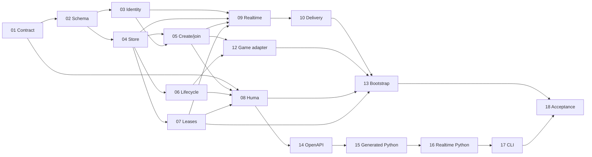

# Generic lobby implementation task pack

This task pack records the original implementation plan. Paths and commands refer to the monorepo root unless stated otherwise; the reusable component now lives entirely under `lobby/` with its own Go module. See [the component guide](../../../README.md) for standalone commands.

Prepared against commit `186a2e5` on 2026-09-20. Implementation is complete; [implementation status](implementation-status.md) records completed work, model assignments and actual test evidence. The task files contain the current specifications.

Implement a reusable Go lobby package in this repository, extract connection and membership responsibilities from Island Battles, and generate a working Python HTTP client from Huma OpenAPI with an asyncio Centrifugo companion. This pack is designed for small agents working in parallel.

Read [the architecture decision](../../multiplayer-architecture.md), [architecture](architecture.md), [contracts](contracts.md), and [test matrix](test-matrix.md) before your assigned task. The contract is normative: do not independently rename fields, change lifecycle rules, or invent a second authentication scheme. Report a contract conflict to the coordinator before dependent implementation.

## Scope

Included: guest identity, explicit create/join/leave, team selection, host/ready/start lifecycle, durable membership and reconnect grace, authorized Centrifugo delivery, fresh PostgreSQL schema initialization, an Island Battles adapter, reproducible Python generation, and a runnable multi-player Python example.

Deferred: account/password/OAuth management, matchmaking, invitations beyond join codes, spectators, kicking/banning, multiple backend deployments, Lambda dispatch, game round timers, game action authorization overhaul, C#/TypeScript SDKs, and game-specific Python commands. Starting a lobby freezes its roster for game creation; it does not invoke Lambda or begin simulation.

The guest credential is a bearer capability issued by this backend. Display names and join codes are not identities, and callers cannot select a player ID.

## Task order and exclusive ownership

Each task file lists exact implementation steps, edge cases, tests, and completion evidence. Shared files have one owner. Another agent must request that owner make a change instead of editing the same file concurrently.

| Task | Deliverable | Prerequisites | Main ownership |
| --- | --- | --- | --- |
| [01](01-domain-contract.md) | Domain types, ports, policy helpers | None | `lobby/domain/*.go` |
| [02](02-schema-fixtures.md) | PostgreSQL schema and independent test fixture | 01 | `lobby/postgres/models.go`, `schema.go`, `lobby/internal/testutil/` |
| [03](03-identity.md) | Guest credentials and connection JWTs | 01, 02 | `lobby/auth/`, `lobby/postgres/identity.go` |
| [04](04-transaction-store.md) | Locked aggregate store and atomic events | 01, 02 | `lobby/postgres/store*.go`, `outbox_store.go` |
| [05](05-create-join.md) | Create/join/snapshot service | 01, 03, 04 | `lobby/application/service.go`, `membership.go` |
| [06](06-teams-lifecycle.md) | Teams, ready, start, leave | 01, 04; verify with 05 | `lobby/application/teams.go`, `lifecycle.go` |
| [07](07-reconnect-leases.md) | Heartbeats, release, deadline sweeper | 01, 04; verify with 05, 06 | `lobby/application/leases.go`, `sweeper.go` |
| [08](08-huma-api.md) | Public Huma DTOs and routes | 01; verify with 03, 05–07 | `lobby/httpapi/` |
| [09](09-centrifugo-adapter.md) | Proxy authorization and transport adapter | 01, 03, 04; verify with 05, 07 | `lobby/realtime/` |
| [10](10-delivery-worker.md) | Retried outbox delivery and revocation | 04, 09 | `lobby/delivery/` |
| [12](12-island-adapter.md) | Game model extraction and explicit binding | 05, 06 | `backend/models/game.go`, game DAL, `backend/lobbyadapter/` and relevant game tests |
| [13](13-bootstrap-config.md) | Application wiring and Centrifugo configuration | 03, 07–10, 12 | backend entry point/dependencies/routes/test DB fixture, go.mod/go.sum, explicit HTTP flow, Compose/config, Go example |
| [14](14-openapi-export.md) | Offline lobby-only OpenAPI export | 08 | `lobby/cmd/export-lobby-openapi/`, `lobby/api/` |
| [15](15-generated-python.md) | Pinned generation and committed HTTP SDK | 14 | `lobby/clients/lobby-python/` packaging/scripts/generated, excluding runtime/tests below |
| [16](16-python-realtime.md) | Python connection and reconciliation wrapper | 15; contract development may start after 01 | `lobby/clients/lobby-python/lobby_client/`, wrapper unit tests |
| [17](17-python-cli.md) | Runnable CLI and user documentation | 16 | Python examples and client README |
| [18](18-acceptance.md) | Live acceptance tests and final integration | 01–17 | `lobby/integration/`, acceptance scripts, final repository documentation |

## Parallel scheduling

1. Complete 01 first; coordinator checks signatures and records the contract freeze. It must compile without database or network access.
2. Start 02 and DTO work in 08. Once 02 lands, run 03 and 04 concurrently.
3. After 04, run 05, 06, 07, and 09 in independent worktrees. Agents may implement against frozen interfaces, but cannot mark integration checks passed before dependencies land.
4. Run 10 and 12 as their dependencies finish. Complete 08, then 14 → 15 → 16 → 17 while 13 finishes Go/config integration.
5. Run 18 after all integrations. Fix failures in the owning task's files; the coordinator resolves cross-task contract changes and reruns dependent checks.

With four available workers, keep one coordinator and up to three implementation agents. Assign one ready task per agent; do not split a single task across overlapping editors. Use branches/worktrees where available. No agent should merge speculative interfaces from an unfinished prerequisite.



## Instructions to every implementation agent

Coordinator assignment template (replace the task path and prerequisite handoff):

```text
Implement only lobby/docs/tasks/generic-lobby/NN-task-name.md.
Read that file, README.md, architecture.md, contracts.md, and test-matrix.md in the same directory.
Prerequisites are complete at: <commit/worktree and handoff>.
Other agents are working concurrently. Edit only your task's owned files.
Follow the exact contract and named tests. Send shared-file/dependency changes to the coordinator.
Finish with changed files, commands and actual results, and any unresolved prerequisite or failure.
Do not claim completion with stubs, skipped required checks, or only mock coverage where live tests are required.
```

- Read the backend-development skill when changing Go Huma/GORM code. Read game-state-testing when touching existing game fixtures. Follow README struct/clause query conventions; use explicit column updates for `false`, zero, and SQL NULL.
- Do not move game simulation into `lobby/`. `go list -deps ./lobby/...` must contain no `islandBattles/backend/` dependency. The generic component now owns its Go module in `lobby/go.mod`; keep its dependencies independent of the host module.
- Keep tests beside the owned implementation except final acceptance tests. PostgreSQL tests must use disposable PostgreSQL, not SQLite or the developer's Compose database.
- Concurrency tests use barriers and independent DB connections. Time tests use an injected clock. Do not rely on sleeps to prove races or grace deadlines.
- No synthetic successful stubs, skipped checks reported as passing, network calls during OpenAPI export, or hand-edited generated Python.
- A task is done only when its required tests pass, its public contracts match, and its handoff lists changed files, commands/results, remaining limitations, and dependencies not yet integrated.
- Add focused tests specified here, not redundant tests mirroring trivial field assignments. Leave unrelated files alone.

## Final completion gate

The project is complete only after a clean checkout can initialize the fresh schema, run the backend and Centrifugo, generate the exact committed SDK, and use two Python clients to create/join, choose teams, disconnect/reconnect, recover a snapshot, and leave. Failed or unavailable Docker/network checks remain outstanding, with the exact command and reason recorded. Documentation must distinguish tested behavior from future Lambda/game integration.
